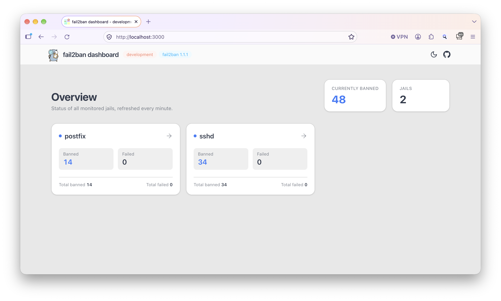
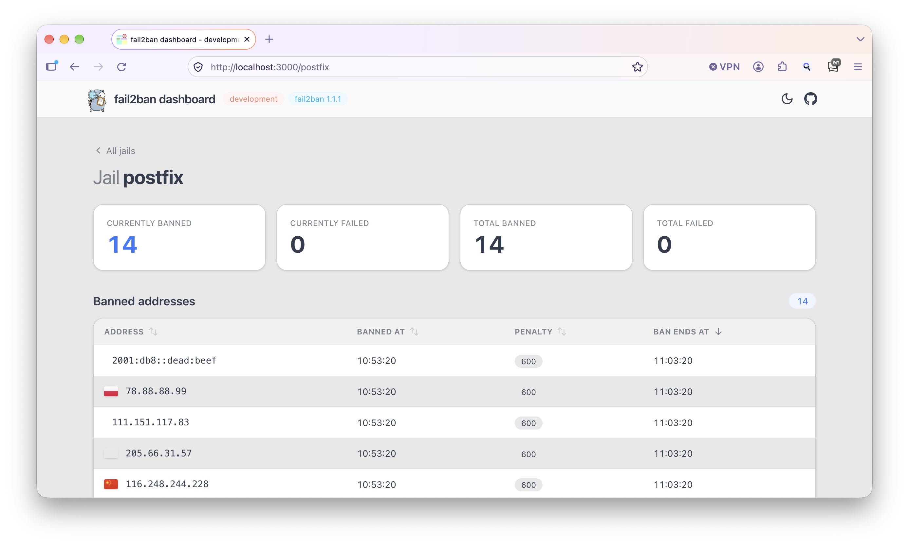
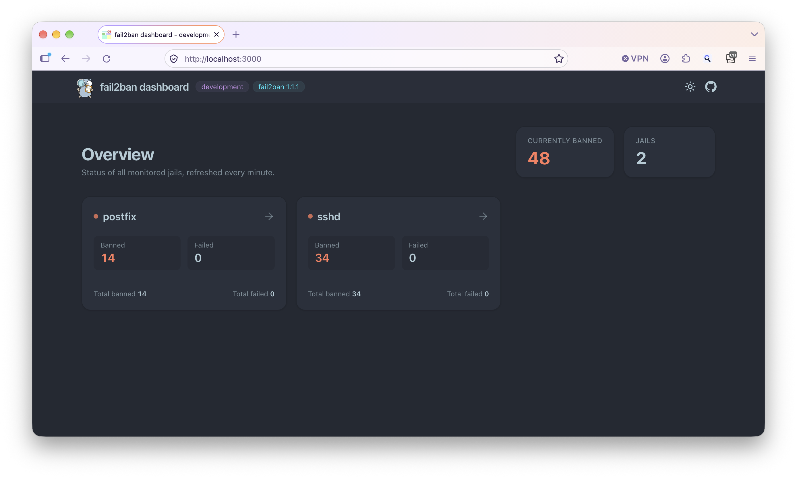
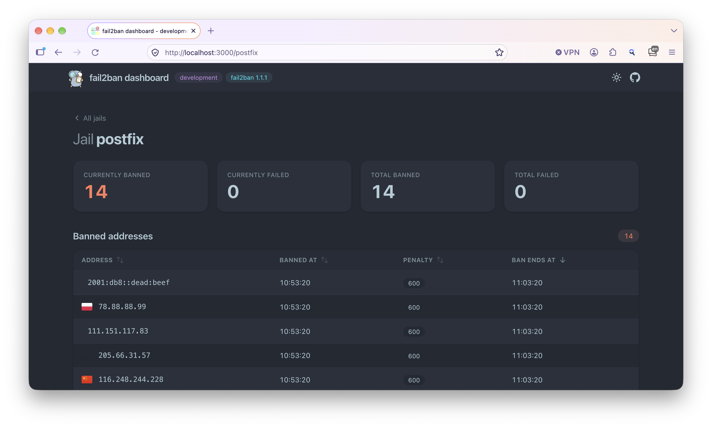
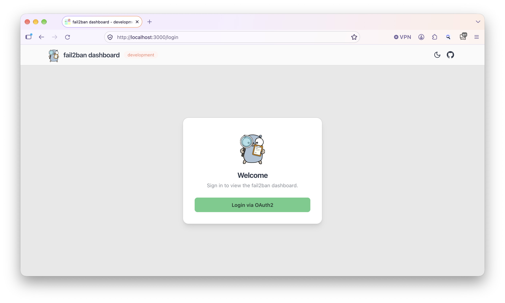
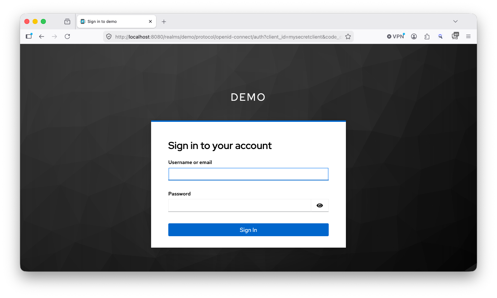
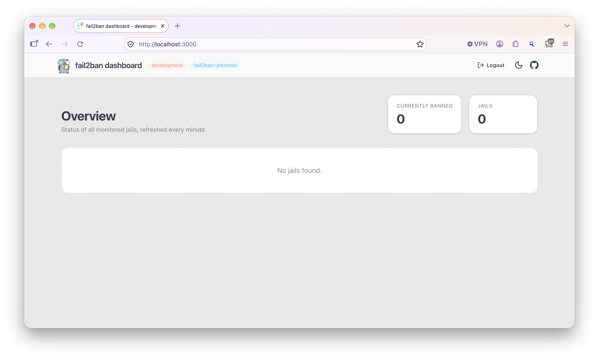

<p align="center">
    <picture>
      <source media="(prefers-color-scheme: dark)" srcset="docs/content/assets/fail2ban-dashboard-mascot_250.png">
      <source media="(prefers-color-scheme: light)" srcset="docs/content/assets/fail2ban-dashboard-mascot_250.png">
      
    </picture>
</p>

# fail2ban-dashboard


A web-based dashboard for `fail2ban` which uses the `/var/run/fail2ban/fail2ban.sock` socket to access `fail2ban`.  
In addition to the dashboard, the application can provide Prometheus metrics related to `fail2ban` when enabled.

Tested with the following `fail2ban` versions

- `0.11.1`
- `0.11.2`
- `1.0.1`
- `1.0.2`
- `1.1.0`
- `1.1.1`

If the dashboard should be used with another version, please switch off the version check with the
`--skip-version-check` flag, otherwise the application won't start.

## Table of Contents

- [Screenshots](#screenshots)
    - [Light mode](#light-mode)
    - [Dark mode](#dark-mode)
    - [OAuth2](#oauth2)
- [Installation](#installation)
    - [Standalone application](#standalone-application)
    - [Docker](#docker)
        - [Running as non-root](#running-as-non-root)
- [Usage](#usage)
    - [Command line](#command-line)
    - [Configuration](#configuration)
        - [Environment variables](#environment-variables)
        - [Basic authentication](#basic-authentication)
        - [OAuth2](#oauth2-1)
        - [Ban and unban addresses](#ban-and-unban-addresses)
    - [Config file](#config-file)
- [Dashboard](#dashboard)
    - [Web application](#web-application)
    - [Metrics](#metrics)
- [Building the application](#building-the-application)
- [Inspired by](#inspired-by)

## Screenshots

### Light mode

| Overview                                                                                                                          | Detail                                                                                                                                |
|-----------------------------------------------------------------------------------------------------------------------------------|---------------------------------------------------------------------------------------------------------------------------------------|
|  |  |

### Dark mode

| Overview                                                                                                                       | Detail                                                                                                                             |
|--------------------------------------------------------------------------------------------------------------------------------|------------------------------------------------------------------------------------------------------------------------------------|
|  |  |

### OAuth2

<details>
<summary>OAuth2</summary>

| Login                                                                                                                             | Keycloak                                                                                    | Overview                                                                                                                                                  |
|-----------------------------------------------------------------------------------------------------------------------------------|---------------------------------------------------------------------------------------------|-----------------------------------------------------------------------------------------------------------------------------------------------------------|
|  |  |  |

</details>

## Installation

### Standalone application

When using `fail2ban-dashboard` as a standalone application, grab a released version from
the [releases page](https://github.com/webishdev/fail2ban-dashboard/releases).

### Docker

With Docker use

`docker run -v /var/run/fail2ban/fail2ban.sock:/var/run/fail2ban/fail2ban.sock:ro -v f2bd-data:/f2b-dashboard-data -p 3000:3000 ghcr.io/webishdev/fail2ban-dashboard:latest`

The container runs as `root` as by default the `fail2ban` socket is only accessible for the `root` user.
The working directory is `/f2b-dashboard-data`, the GeoIP cache and the tracking database are stored there.

Instead of `latest` you can use a specific version like `v0.13.1`

#### Running as non-root

The container can also run with a non-root user, but this requires changes on the host as the socket is mounted with
the permissions of the host. The `fail2ban` socket must be writable for a group which is then added to the container.

As `fail2ban` recreates the socket on every start, the permissions can be set with a systemd drop-in, e.g.
`/etc/systemd/system/fail2ban.service.d/socket-group.conf` for an existing group `f2bdash`:

```ini
[Service]
ExecStartPost=/bin/sh -c 'while [ ! -S /var/run/fail2ban/fail2ban.sock ]; do sleep 0.5; done; chgrp f2bdash /var/run/fail2ban/fail2ban.sock; chmod 660 /var/run/fail2ban/fail2ban.sock'
```

Then start the container with the user `65532` (`nonroot` of the distroless image) and the group id of `f2bdash`:

`docker run --user=65532:65532 --group-add=$(getent group f2bdash | cut -d: -f3) -v /var/run/fail2ban:/var/run/fail2ban:ro -v /path/to/f2b-dashboard-data:/f2b-dashboard-data -p 3000:3000 ghcr.io/webishdev/fail2ban-dashboard:latest`

- The directory `/var/run/fail2ban` is mounted instead of the socket file, so a recreated socket is still visible in the container
- The mounted `/f2b-dashboard-data` directory must be writable for the user `65532`, e.g. `chown 65532:65532 /path/to/f2b-dashboard-data`.
  When using a named volume instead, mount it with `--mount type=volume,src=<name>,dst=/f2b-dashboard-data,volume-nocopy`, otherwise
  Docker resets the ownership of an empty volume to `root`
- Members of the group have full control over `fail2ban` through the socket

## Usage

### Command line

```
Usage:
  fail2ban-dashboard [command]

Available Commands:
  completion  Generate the autocompletion script for the specified shell
  help        Help about any command
  serve       Start the fail2ban dashboard server
  version     Print the version number and git hash

Flags:
  -h, --help   help for fail2ban-dashboard

Use "fail2ban-dashboard [command] --help" for more information about a command.
```

The dashboard is started with the `serve` command, all options are available for this command:

```
Usage:
  fail2ban-dashboard serve [flags]

Flags:
  -a, --address string               address to serve the dashboard on, also F2BD_ADDRESS (default "127.0.0.1:3000")
      --allow-ban strings            allow banning addresses in the given jail (can be used multiple times), also F2BD_ALLOW_BAN
      --allow-ban-all                allow banning addresses in all jails, also F2BD_ALLOW_BAN_ALL
      --allow-unban strings          allow unbanning addresses in the given jail (can be used multiple times), also F2BD_ALLOW_UNBAN
      --allow-unban-all              allow unbanning addresses in all jails, also F2BD_ALLOW_UNBAN_ALL
      --auth-password string         password for basic auth, also F2BD_AUTH_PASSWORD
      --auth-user string             username for basic auth, also F2BD_AUTH_USER
      --base-path string             base path of the application, also F2BD_BASE_PATH (default "/")
  -c, --cache-dir string             directory to cache GeoIP data, also F2BD_CACHE_DIR (default current working directory)
  -h, --help                         help for serve
      --log-level string             log level (trace, debug, info, warn, error), also F2BD_LOG_LEVEL (default "info")
  -m, --metrics                      will provide metrics endpoint, also F2BD_METRICS
      --metrics-address string       address to make metrics available, also F2BD_METRICS_ADDRESS (default "127.0.0.1:9100")
      --oauth2-auth-url string       OAuth2 authentication URL, also F2BD_OAUTH2_AUTH_URL
      --oauth2-client-id string      OAuth2 client identifier, also F2BD_OAUTH2_CLIENT_ID
      --oauth2-redirect-url string   OAuth2 redirect URL, also F2BD_OAUTH2_REDIRECT_URL
      --oauth2-timeout-minutes int   OAuth2 timeout minutes, also F2BD_OAUTH2_TIMEOUT_MINUTES (default 30)
      --oauth2-token-url string      OAuth2 token URL, also F2BD_OAUTH2_TOKEN_URL
      --refresh-seconds int          fail2ban data refresh in seconds (value from 10 to 600), also F2BD_REFRESH_SECONDS (default 30)
      --scheduled-geoip-download     will keep GeoIP cache update even without accessing the dashboard, also F2BD_SCHEDULED_GEOIP_DOWNLOAD (default true)
      --skip-version-check           skip fail2ban version check (use at your own risk), also F2BD_SKIP_VERSION_CHECK
  -s, --socket string                location of the fail2ban socket, also F2BD_SOCKET (default "/var/run/fail2ban/fail2ban.sock")
      --track                        track bans in a local SQLite database for one year and show charts, also F2BD_TRACK
      --track-db string              location of the SQLite database used for tracking, also F2BD_TRACK_DB (default fail2ban-dashboard.db in current working directory)
      --trust-proxy-headers          trust proxy headers like X-Forwarded-For, also F2BD_TRUST_PROXY_HEADERS
```

### Configuration

#### Environment variables

Environment variables can be used to set parameters without using command line flags.

| Environment Variable       | Command Line Flag       | Description                                 | Default                           |
|----------------------------|-------------------------|---------------------------------------------|-----------------------------------|
| `F2BD_ADDRESS`             | `-a, --address`         | Address to serve the dashboard on           | `127.0.0.1:3000`                  |
| `F2BD_BASE_PATH`           | `--base-path`           | Base path of the application                | `/`                               |
| `F2BD_CACHE_DIR`           | `-c, --cache-dir`       | Directory to cache GeoIP data               | Current working directory         |
| `F2BD_LOG_LEVEL`           | `--log-level`           | Log level (trace, debug, info, warn, error) | `info`                            |
| `F2BD_METRICS`             | `-m, --metrics`         | Enables Prometheus metrics                  | `false`                           |
| `F2BD_METRICS_ADDRESS`     | `--metrics-address`     | Address to serve the metrics                | `127.0.0.1:9100`                  |
| `F2BD_REFRESH_SECONDS`     | `--refresh-seconds`     | Refresh seconds for fail2ban data (10-600)  | `30`                              |
| `F2BD_SKIP_VERSION_CHECK`  | `--skip-version-check`  | Skip fail2ban version check                 | `false`                           |
| `F2BD_SOCKET`              | `-s, --socket`          | Fail2ban socket path                        | `/var/run/fail2ban/fail2ban.sock` |
| `F2BD_TRUST_PROXY_HEADERS` | `--trust-proxy-headers` | Trust proxy headers like X-Forwarded-For    | `false`                           |

#### Basic authentication

Basic authentication can be enabled with the `--auth-user` and/or `--auth-password` flags.  
When only `--auth-user` is provided, the password will be generated and shown in the logs/console.  
When only `--auth-password` is provided, the user will be named `admin`.

| Environment Variable | Command Line Flag | Description             | Default |
|----------------------|-------------------|-------------------------|---------|
| `F2BD_AUTH_PASSWORD` | `--auth-password` | Password for basic auth | -       |
| `F2BD_AUTH_USER`     | `--auth-user`     | Username for basic auth | -       |

#### OAuth2

When using OAuth2 authentication, `fail2ban-dashboard` requires the following environment variables or command line
flags to be set when no default value is provided:

| Environment Variable          | Command Line Flag          | Description                    | Default |
|-------------------------------|----------------------------|--------------------------------|---------|
| `F2BD_OAUTH2_CLIENT_ID`       | `--oauth2-client-id`       | OAuth2 client identifier       | -       |
| `F2BD_OAUTH2_AUTH_URL`        | `--oauth2-auth-url`        | OAuth2 authorization URL       | -       |
| `F2BD_OAUTH2_TOKEN_URL`       | `--oauth2-token-url`       | OAuth2 token URL               | -       |
| `F2BD_OAUTH2_REDIRECT_URL`    | `--oauth2-redirect-url`    | OAuth2 redirect URL            | -       |
| `F2BD_OAUTH2_TIMEOUT_MINUTES` | `--oauth2-timeout-minutes` | OAuth2 session timeout minutes | 30      |

All values that do not provide a default value are required and must be set.
The `OAuth2 redirect URL` must be set to the URL of the `fail2ban-dashboard` application, which is usually
`http://127.0.0.1:3000` but allows to provide URLs when used with a reverse proxy like `https://fail2ban.example.com`.

Example CLI setup with a local Keycloak instance running at `http://localhost:8080` and providing a `demo` realm:

`./fail2ban-dashboard serve --oauth2-client-id mysecretclient --oauth2-auth-url http://localhost:8080/realms/demo/protocol/openid-connect/auth --oauth2-token-url http://localhost:8080/realms/demo/protocol/openid-connect/token --oauth2-redirect-url http://localhost:3000`

#### Ban and unban addresses

By default, the dashboard is read-only. Banning and unbanning addresses can be enabled for all jails or for single jails.
The jail specific flags can be used multiple times. Jails that do not exist are ignored.

| Environment Variable   | Command Line Flag       | Description                                    | Default |
|------------------------|-------------------------|------------------------------------------------|---------|
| `F2BD_ALLOW_BAN_ALL`   | `--allow-ban-all`       | Allow banning addresses in all jails           | `false` |
| `F2BD_ALLOW_UNBAN_ALL` | `--allow-unban-all`     | Allow unbanning addresses in all jails         | `false` |
| `F2BD_ALLOW_BAN`       | `--allow-ban <jail>`    | Allow banning addresses in the given jail(s)   | -       |
| `F2BD_ALLOW_UNBAN`     | `--allow-unban <jail>`  | Allow unbanning addresses in the given jail(s) | -       |

When banning is allowed for a jail, its detail page shows a `Ban address` button, which opens a dialog to enter an IPv4
or IPv6 address. When unbanning is allowed, every banned address in the table of the jail gets an `Unban` button.
When banning is allowed for all jails, the overview page additionally shows a `Ban address` button, which bans the
address in all jails at once.

The detail page of a jail is available at `/jail/<name>`, e.g. `/jail/sshd`.

Multiple jails can be provided as environment variable separated by comma or space, e.g. `F2BD_ALLOW_BAN="sshd,postfix"`.

Example to allow banning in the `sshd` and `postfix` jails and unbanning in all jails:

`./fail2ban-dashboard serve --allow-ban sshd --allow-ban postfix --allow-unban-all`

Make sure to protect the dashboard with basic authentication or OAuth2 when enabling these actions.

#### Ban tracking

With `--track` every ban seen while refreshing the fail2ban data is stored in a local SQLite database.
The overview page and the jail detail pages then show a chart with the number of bans for the last week, month
(one bar per day) or year (one bar per month). Bans older than one year are removed from the database.

| Environment Variable | Command Line Flag | Description                              | Default                                              |
|----------------------|-------------------|------------------------------------------|------------------------------------------------------|
| `F2BD_TRACK`         | `--track`         | Track bans and show charts               | `false`                                              |
| `F2BD_TRACK_DB`      | `--track-db`      | Location of the SQLite database for bans | `fail2ban-dashboard.db` in current working directory |

The directory of the database is created when missing. The history starts when tracking is enabled, only bans that are
active during a refresh are recorded, so bans shorter than `--refresh-seconds` may be missed.
When running in Docker, the database is stored in the working directory `/f2b-dashboard-data` by default, so mount a volume
there to keep the history between container restarts.

### Configuration file

It is also possible to configure `fail2ban-dashboard` using a config file.
Supported config file formats are the ones supported by the [viper](https://github.com/spf13/viper#reading-config-files)
library.

The config file can be located at the current working directory, the user home directory `~/.config/fail2ban-dashboard/`
or `/etc/fail2ban-dashboard/`.
When running in Docker, the working directory is `/f2b-dashboard-data`, so a config file can be placed on the mounted volume.

For example, for a TOML file located at `/etc/fail2ban-dashboard/config.toml` to change the address should look like:

```toml
address = "127.0.0.1:4000"
```

Supported configuration names are similar to flags and environment variables:

| Configuration       |
|---------------------|
| socket              |
| address             |
| auth-user           |
| auth-password       |
| cache-dir           |
| log-level           |
| base-path           |
| metrics-address     |
| oauth2-client-id    |
| oauth2-auth-url     |
| oauth2-token-url    |
| oauth2-redirect-url |
| allow-ban-all       |
| allow-unban-all     |
| allow-ban           |
| allow-unban         |
| track               |
| track-db            |

## Dashboard

### Web application

When started, check http://127.0.0.1:3000/

### Metrics

When metrics are enabled with `-m` the metrics endpoint is available at http://127.0.0.1:9100/metrics and the address
can be changed with `--metrics-address`.

The following example shows which metrics are provided

```text
# HELP f2b_banned_total The total number of banned addresses
# TYPE f2b_banned_total gauge
f2b_banned_total 46
# HELP f2b_jail_banned_current Amount of banned IPs currently in jail
# TYPE f2b_jail_banned_current gauge
f2b_jail_banned_current{jail="postfix"} 13
f2b_jail_banned_current{jail="sshd"} 33
# HELP f2b_jail_banned_total Amount of banned IPs total in jail
# TYPE f2b_jail_banned_total gauge
f2b_jail_banned_total{jail="postfix"} 13
f2b_jail_banned_total{jail="sshd"} 33
# HELP f2b_jail_count The number of jails in fail2ban
# TYPE f2b_jail_count gauge
f2b_jail_count 2
# HELP f2b_jail_failed_current Amount of failed IPs currently in jail
# TYPE f2b_jail_failed_current gauge
f2b_jail_failed_current{jail="postfix"} 0
f2b_jail_failed_current{jail="sshd"} 0
# HELP f2b_jail_failed_total Amount of failed IPs total in jail
# TYPE f2b_jail_failed_total gauge
f2b_jail_failed_total{jail="postfix"} 0
f2b_jail_failed_total{jail="sshd"} 0
# HELP fail2ban_dashboard_info The fail2ban Dashboard build information
# TYPE fail2ban_dashboard_info gauge
fail2ban_dashboard_info{fail2ban_version="1.1.0",version="development"} 1
```

## Building the application

### Requirements

To build the application, the Go version specificed in the `go.mod` file must be installed.
Furthermore, the `make` utility must be installed.

### Building

To build the application, use make with the following options:

```
> make help

Available targets:
  all         - Run tests, lint, and build for all platforms (default)
  build-all   - Build for all platforms (Intel and ARM)
  build-intel - Build Linux binary for Intel CPUs (amd64)
  build-arm   - Build Linux binary for ARM CPUs (arm64)
  build       - Build for specified GOOS/GOARCH
  lint        - Run golangci-lint
  test        - Run tests
  test-ci     - Run tests with JSON output for CI/CD
  clean       - Remove build artifacts
  help        - Show this help message

Variables:
  VERSION - Version to embed in binary (default: development)
  GOOS    - Target operating system (default: linux)
  GOARCH  - Target architecture (default: amd64)

Examples:
  make build-all
  make build-intel VERSION=v1.0.0
  make build GOOS=darwin GOARCH=arm64
  make clean
```

## Inspired by

- https://github.com/fail2ban/fail2ban
- https://gitlab.com/hctrdev/fail2ban-prometheus-exporter/-/tree/main?ref_type=heads
- https://github.com/VerifiedJoseph/intruder-alert?tab=readme-ov-file
